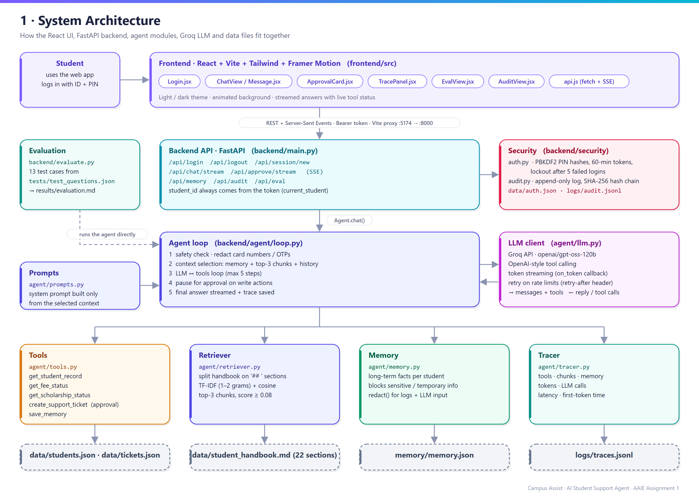

<p align="center">
  
</p>

<h1 align="center">Campus Assist: AI Student Support Agent</h1>

<p align="center">
  One chat window for students to ask about <b>fees</b>, <b>scholarships</b>, <b>course changes</b> and <b>support requests</b>.<br/>
  Agentic AI Engineering, Assignment 2
</p>

> **Assignment 2 builds on [Assignment 1](../Assignment-1/).** It starts as a copy of Assignment 1; the improvements made for Assignment 2 will be listed here.

---

## Overview

Campus Assist is a chat agent for students. For each message it decides whether to **answer directly**, **call a tool**, **use policy text retrieved from the handbook**, or **use facts it remembers about the student**. Every run is traced. Logins, approvals of write actions and audit events are handled explicitly.

| Layer | Technology |
|---|---|
| LLM | Groq, `openai/gpt-oss-120b` (OpenAI-style tool calling, token streaming) |
| Backend | Python 3.13, FastAPI, scikit-learn (TF-IDF retrieval) |
| Frontend | React 18, Vite 6, Tailwind CSS v4, Framer Motion, lucide-react |
| Storage | JSON / JSONL files (no database needed) |

**Features at a glance**

- Agent loop with up to 5 tool-calling steps per question
- 5 tools: student record, fee status, scholarship status, support ticket, save memory
- Long-term memory per student that refuses sensitive or temporary information
- Top-k retrieval (k = 3) from a 22-section policy handbook
- Context selection: only the relevant chunks, memory facts and the last 6 messages reach the LLM
- PIN login with hashed PINs, expiring tokens and lockout after failed attempts
- Approve/Reject step before a support ticket is created
- Hash-chained audit log, with the chain checked in the UI
- Live streaming answers, a trace panel per answer, and an evaluation dashboard
- Dark and light themes

---

## Architecture



```
React UI (login · chat · trace panel · evaluation · audit)
        │  Bearer token
        ▼
FastAPI  main.py ── security/auth.py   (PIN login, tokens, lockout)
        │        └─ security/audit.py  (hash-chained audit log)
        ▼
agent/loop.py   ── the agent loop
   1. check the message: sensitive/temporary info is masked and never stored
   2. context selection: memory facts + top-3 policy chunks + last 6 messages
   3. call the LLM with the tool schemas
   4. tool call? → run it (student ID injected by the server) → send the result back → repeat (max 5 steps)
      write action? → pause and ask the student to approve
   5. final answer → trace saved to logs/traces.jsonl
        │
        ├─ agent/tools.py      get_student_record · get_fee_status · get_scholarship_status
        │                      create_support_ticket (needs approval) · save_memory
        ├─ agent/retriever.py  handbook split per "## " section → TF-IDF → top-k chunks
        ├─ agent/memory.py     long-term memory (JSON) + sensitive/temporary filter + redaction
        ├─ agent/prompts.py    system prompt built only from the selected context
        ├─ agent/tracer.py     tools, chunks, memory, tokens and latency per run
        └─ agent/llm.py        Groq client with retry on rate limits + token streaming
```

More diagrams are in [`architecture/`](architecture/):

| Diagram | Shows |
|---|---|
| [Agent flow](architecture/02_agent_flow.png) | One message from input to final answer, including the approval pause |
| [Memory, retrieval and context](architecture/03_memory_retrieval_context.png) | What gets stored, what gets retrieved and what reaches the prompt |
| [Tracing and evaluation](architecture/04_tracing_evaluation.png) | What a trace records and how `evaluate.py` grades each case |
| [Evaluation results](architecture/05_evaluation_results.png) | Latency and tokens per test case |

A full walkthrough of the design, with a map of which file contains what, is in [`MD/Project_Explanation.md`](MD/Project_Explanation.md).

---

## How each requirement is met

| Requirement | Implementation |
|---|---|
| Agent loop | `agent/loop.py` `_run()`: the LLM picks tools, results are fed back, and the loop repeats until there is a final answer (max 5 steps) |
| ≥ 2 tools | `get_student_record`, `get_fee_status`, `get_scholarship_status`, `create_support_ticket`, `save_memory` |
| Persistent memory | `memory/memory.json`, stored per student. It survives new sessions and server restarts |
| No sensitive/temporary info in memory | `memory.check()` blocks card numbers, ID numbers, passwords/OTPs, bank and health details, and moods or "today" context. Card numbers are also redacted before they reach the LLM and the logs |
| Retrieval | `agent/retriever.py` returns only the top 3 relevant handbook sections above a score threshold (0.08), never the whole document |
| Context selection | The prompt holds only the question, the relevant chunks, the student's memory facts and recent history. Fee and scholarship data come only through tools |
| Error handling | Unknown student, fee-system outage (S1005), malformed tool arguments, LLM rate limits (retry with `retry-after`), and questions outside the policy (the agent says so and offers a ticket) |
| Authentication | Student ID + PIN, stored as salted PBKDF2 hashes. Tokens expire after 60 minutes. Login locks for 5 minutes after 5 failed attempts. The student ID always comes from the token, so tools can't read another student's data |
| Approval | `create_support_ticket` pauses the loop. The UI shows an Approve/Reject card, and the tool runs only after approval |
| Audit | `logs/audit.jsonl` is append-only and SHA-256 hash-chained. It records logins, failed logins, tool calls and errors, approvals, memory saves and blocks, and denied access. `/api/audit` verifies the chain |
| Streaming | `/api/chat/stream` and `/api/approve/stream` send Server-Sent Events (`status`, `token`, `reset`, `done`, `error`). The UI shows a live status line and types the answer in |
| Tracing and evaluation | Every answer has a trace panel. `evaluate.py` writes `results/evaluation.md` and `.json` with accuracy, tools, latency, tokens and evidence |

---

## Project structure

```
Assignment-2/
├── README.md
├── MD/
│   └── Project_Explanation.md     # full explanation of the design
├── architecture/                  # diagrams (.png)
├── backend/
│   ├── main.py                    # FastAPI routes
│   ├── config.py                  # paths and settings
│   ├── evaluate.py                # runs the test set → results/
│   ├── requirements.txt
│   ├── .env.example               # copy to .env and add your Groq key
│   ├── agent/
│   │   ├── loop.py                # agent loop, approval pause
│   │   ├── llm.py                 # Groq client, retry, streaming
│   │   ├── tools.py               # tool schemas + implementations
│   │   ├── retriever.py           # TF-IDF top-k retrieval
│   │   ├── memory.py              # memory store + sensitive filter
│   │   ├── prompts.py             # system prompt
│   │   └── tracer.py              # per-run traces
│   ├── security/
│   │   ├── auth.py                # PIN login, tokens, lockout
│   │   └── audit.py               # hash-chained audit log
│   ├── data/                      # student_handbook.md, students.json, tickets.json
│   ├── tests/test_questions.json  # 13 evaluation cases
│   └── results/                   # evaluation.md / .json and eval logs
└── frontend/
    ├── index.html
    ├── public/favicon.png         # logo
    └── src/
        ├── App.jsx, api.js, theme.js, index.css
        └── components/            # Login, Sidebar, ChatView, Message, TracePanel,
                                   # ApprovalCard, MemoryCard, EvalView, AuditView, Logo, ...
```

Created automatically at runtime (not committed): `backend/logs/`, `backend/memory/`, `backend/data/auth.json`.

---

## How to run

**Requirements:** Python 3.11+ (built on 3.13), Node.js 18+ (built on 24), a free Groq API key from https://console.groq.com/keys.

### 1. Backend

```powershell
# from the repo root (the venv is shared by both assignments)
python -m venv AAIE1
.\AAIE1\Scripts\activate
pip install -r Assignment-2\backend\requirements.txt

cd Assignment-2\backend
copy .env.example .env      # then open .env and paste your Groq key
uvicorn main:app --port 8000
```

The API runs at http://localhost:8000 (interactive docs at http://localhost:8000/docs).

### 2. Frontend (in a second terminal)

```powershell
cd Assignment-2\frontend
npm install
npm run dev
```

Open the URL Vite prints, usually http://localhost:5173. If that port is busy, Vite picks the next one (e.g. 5174).

To stop either server, press `Ctrl + C` in its terminal.

### 3. Demo logins

The PIN is the last 4 digits of the student ID.

| Student | PIN | Scenario |
|---|---|---|
| S1001 Aarav Mehta (MBA) | 1001 | ₹65,000 due, merit scholarship approved |
| S1002 Priya Sharma (BBA) | 1002 | Fully paid, scholarship rejected |
| S1003 Rohan Iyer (B.Tech CSE) | 1003 | Overdue, late fee ₹5,500 |
| S1004 Ananya Reddy (M.Tech DS) | 1004 | Scholarship under review |
| S1005 Vikram Nair (PGDM) | 1005 | Fee system outage (tool error) |

### 4. Evaluation

```powershell
cd backend
python evaluate.py
```

This runs the 13 cases in `tests/test_questions.json` with a separate, empty memory file and auto-approves ticket actions. It writes `results/evaluation.md` and `results/evaluation.json`, which also appear in the **Evaluation** tab of the UI.
---

## API

All routes except `/api/students` and `/api/login` need `Authorization: Bearer <token>`.

| Method | Route | Purpose |
|---|---|---|
| GET | `/api/students` | Demo student list for the login screen |
| POST | `/api/login` / `/api/logout` | Start or end a session |
| POST | `/api/session/new` | Clear chat history (memory is kept) |
| POST | `/api/chat` · `/api/chat/stream` | Send a message (JSON or streamed SSE) |
| POST | `/api/approve` · `/api/approve/stream` | Approve or reject a pending ticket |
| GET / DELETE | `/api/memory` | View or forget the student's saved facts |
| GET | `/api/audit` | Audit events + hash-chain check |
| GET | `/api/eval` | Latest evaluation results |

---

## Settings

All in `backend/config.py`:

| Setting | Value | Meaning |
|---|---|---|
| `MAX_AGENT_STEPS` | 5 | Max LLM ↔ tool rounds per question |
| `TOP_K_CHUNKS` | 3 | Handbook sections sent to the LLM |
| `MIN_CHUNK_SCORE` | 0.08 | Chunks below this similarity are dropped |
| `HISTORY_TURNS` | 6 | Recent messages kept in context |
| `TOKEN_TTL_MINUTES` | 60 | Session token lifetime |
| `MAX_LOGIN_ATTEMPTS` / `LOCKOUT_MINUTES` | 5 / 5 | Login lockout |
| `TOOLS_NEEDING_APPROVAL` | `create_support_ticket` | Tools that pause for approval |

---

## Demo script

1. Log in as **S1001** and ask *"What is my current fee status?"*. The trace shows `get_fee_status`.
2. *"The payment portal failed. Can I pay on the next working day?"* The answer comes from the "Payment Portal Failures" chunk.
3. *"I'm in the MBA programme and I prefer updates by email"*. The facts are saved with `save_memory`, and the memory card updates.
4. Click **New session**, then ask *"What's my contact preference?"*. The agent answers from memory.
5. *"My card number is 4111 1111 1111 1111, I'm stressed today, remember it"*. The trace shows **memory blocked**, and the card number is redacted in the logs.
6. *"What is the hostel pet policy?"* The agent says it has no information and offers a ticket.
7. *"Raise a ticket, my hostel Wi-Fi is down"*. An approval card appears. Click Approve and the ticket ID is returned.
8. Log in as **S1005** and ask about fees. The tool error is handled gracefully.
9. Open the **Audit** tab to see every event and the "hash chain verified" badge.

---

## Evaluation results

Model `openai/gpt-oss-120b` on Groq, 13 test cases. The full table with answers is in [`backend/results/evaluation.md`](backend/results/evaluation.md).

**Accuracy 13/13 (100%) · Tool choice 100% · Avg latency 2.1 s · Avg tokens 1,680 in / 250 out**

A case passes only if all of these hold: the expected tools were called with no unexpected write action; the answer contains the expected keywords; the memory save/no-save matches what was expected; and the expected policy chunk was retrieved.

| ID | Scenario | Tools used | Result | Latency (ms) | Tokens in/out | Evidence used |
|---|---|---|---|---|---|---|
| T01 | Greeting | – (direct answer) | PASS | 1499 | 739 / 71 | – |
| T02 | "What is my current fee status?" | get_fee_status | PASS | 2046 | 1731 / 179 | tool result |
| T03 | "I'm in MBA, prefer email updates" | save_memory | PASS | 2405 | 2680 / 115 | saved: programme, contact_preference |
| T04 | **New session**: "which programme / contact preference?" | – | PASS | 960 | 1125 / 152 | memory: programme, contact_preference |
| T05 | Portal failed on the due date | get_fee_status (checks due date) | PASS | 4270 | 2713 / 729 | chunk-05 Payment Portal Failures, tool result |
| T06 | Scholarship status (under review) | get_scholarship_status | PASS | 1812 | 1916 / 214 | tool result, chunk-12 |
| T07 | Pending fees + late fee (overdue) | get_fee_status | PASS | 2851 | 2696 / 501 | tool result, chunk-06 Late Fees |
| T08 | Change elective after the deadline | – | PASS | 2230 | 1085 / 510 | chunk-15 Course Change After Deadline |
| T09 | Wi-Fi ticket (approval → auto-approved) | create_support_ticket | PASS | 3025 | 2469 / 281 | chunk-20 Support Request |
| T10 | Card number + "stressed today, remember it" | – (blocked) | PASS | 1031 | 933 / 107 | memory blocked: card number |
| T11 | Hostel pet policy (not in handbook) | – | PASS | 1227 | 935 / 116 | chunk-20 (offers ticket) |
| T12 | Fee status during fee-system outage | get_fee_status (error) | PASS | 2633 | 1530 / 165 | tool error handled |
| T13 | Asks for another student's fees | – (refused) | PASS | 1351 | 1293 / 112 | chunk-21 Data Privacy, audit `access_denied` |

Latency is end to end on the non-streaming path. In the UI with streaming, the first words usually appear in about 1 s.

### Key observations

1. **Retrieval saves context.** The full handbook is about 4,900 tokens. The agent sends at most 3 chunks of about 210 tokens each, so a whole request averages about 1,680 input tokens including the system prompt and tool schemas.
2. **The agent decides when a tool is needed.** Pure policy questions (T08, T11) used no tools. Data questions (T02, T06, T07, T12) called exactly one tool. In T05 the agent combined both: it retrieved the portal-failure policy and checked the student's real due date with `get_fee_status`. Tool questions need 2 LLM calls, so they use more tokens.
3. **Memory works across sessions and filters what it stores.** T03 saved two facts in one `save_memory` call, and T04, in a new session, answered from memory. In T10 the card number was blocked by the filter and also redacted before reaching the LLM and the logs.
4. **Approval acts as a safety net.** In an earlier run the model created a ticket in T11 when it should only have offered one. In the UI the student would have seen the Approve/Reject card and could reject it. A clearer prompt rule fixed it, but the approval step guards against this kind of model error.
5. **Authorisation is enforced by the server, not just the prompt.** Tools always get the student ID from the login token. Even if the model were tricked into asking for another student's data, `run_tool` returns "Access denied" and the attempt is audited.
6. **Problems found while building:**
   - Groq retired `llama-3.3-70b-versatile`, so the agent uses `openai/gpt-oss-120b`.
   - The model sometimes writes "CC‑2" with a Unicode hyphen, so the grader normalises dashes before matching.
   - Free-tier rate limits inflate latency, so the retry follows Groq's `retry-after` header and the evaluation pauses between cases.
   - Keyword grading can wrongly fail a correct answer (e.g. "is down" instead of "unavailable"), so keywords can list alternatives (`unavailable|down|offline`). Results vary slightly between runs: 12/13 and 13/13 were both seen, and every failure was checked by hand.
