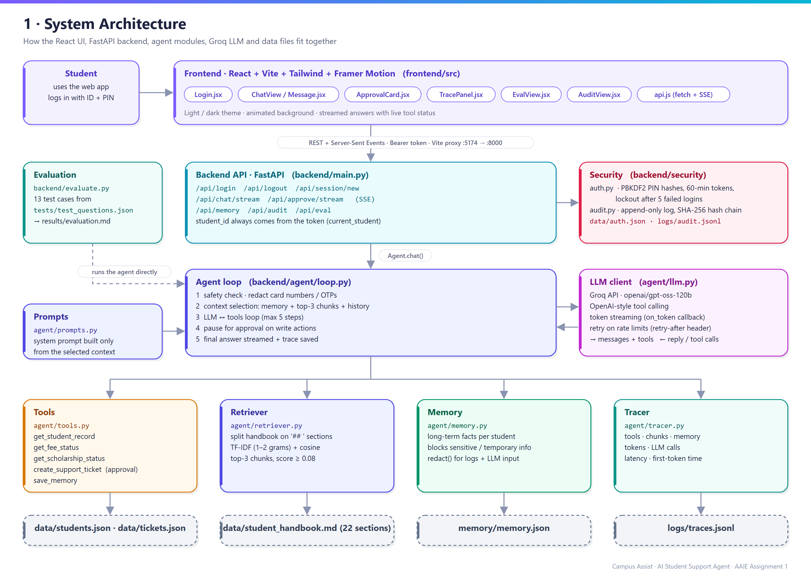
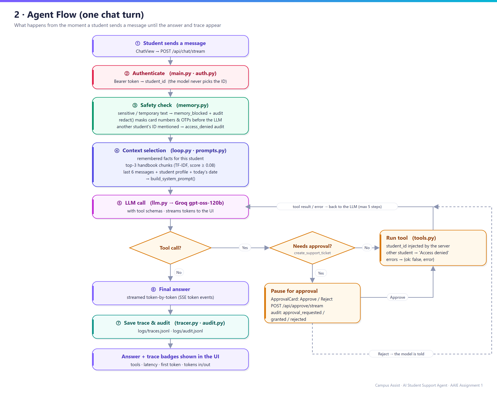
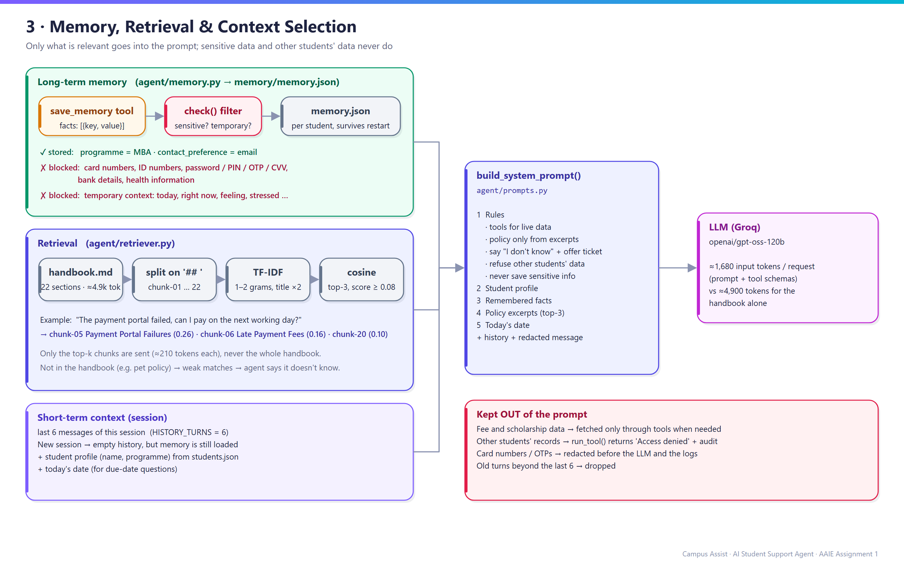
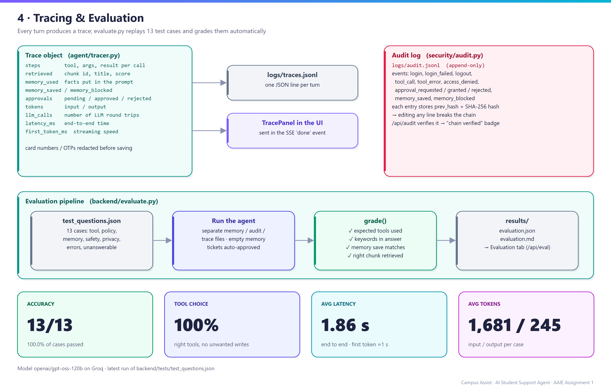
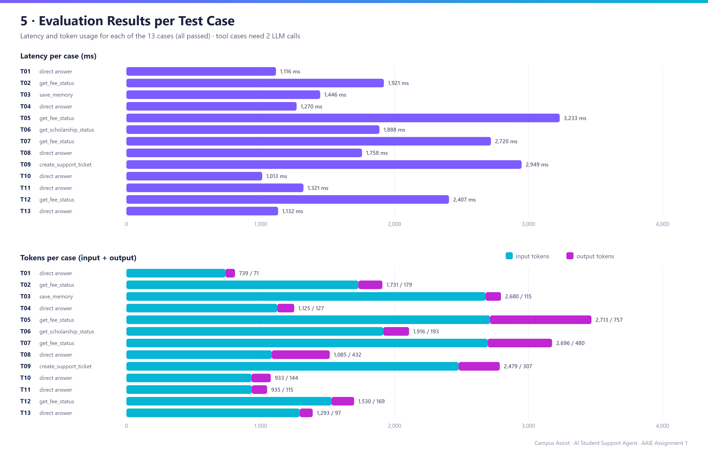

# Campus Assist: Project Explanation

**Campus Assist** is an AI Student Support Agent. In one chat window, a student can ask about **fees, scholarships, course changes and support requests**.

- **LLM:** Groq `openai/gpt-oss-120b`, with tool calling and token streaming.
- **Backend:** Python and FastAPI.
- **Frontend:** React, Vite, Tailwind and Framer Motion, with light and dark themes.

The diagrams are in the [`architecture/`](../architecture) folder. Each diagram comes as a PNG for reports and slides, and as an SVG for zooming.

| # | Diagram | Shows |
|---|---|---|
| 1 | [01_system_architecture.png](../architecture/01_system_architecture.png) | All layers: UI → API → agent → tools, retriever, memory and tracer → data files |
| 2 | [02_agent_flow.png](../architecture/02_agent_flow.png) | One chat turn, step by step, including the tool loop and the approval pause |
| 3 | [03_memory_retrieval_context.png](../architecture/03_memory_retrieval_context.png) | What goes into the prompt and what is kept out |
| 4 | [04_tracing_evaluation.png](../architecture/04_tracing_evaluation.png) | Trace fields, audit log, evaluation pipeline and headline results |
| 5 | [05_evaluation_results.png](../architecture/05_evaluation_results.png) | Latency and tokens for each test case |

---

## 1. Overall architecture

The system has four layers:

1. **Frontend (React)**
   - The student logs in and chats.
   - Answers stream in word by word.
   - Each answer has a trace panel.
   - There are also Evaluation and Audit tabs.
2. **API (FastAPI, `main.py`)**
   - Handles login and sessions.
   - Streams chat answers with Server-Sent Events.
   - Serves memory, audit and evaluation data.
   - The student ID always comes from the login token, never from the model.
3. **Agent (`agent/`)**
   - The agent loop decides whether to answer directly, call a tool, use handbook text or use remembered facts.
4. **Data (JSON and Markdown files)**
   - Student records, the policy handbook, tickets, memory, traces and the audit log.

---

## 2. Which file contains what

### Backend: `backend/`

| File | What it contains |
|---|---|
| `main.py` | All API routes (`/api/login`, `/api/chat/stream`, `/api/approve/stream`, `/api/memory`, `/api/audit`, `/api/eval`). Also the `current_student` check, which reads the student ID from the Bearer token, and the SSE streaming helper |
| `config.py` | All settings: paths, model name, `MAX_AGENT_STEPS=5`, `TOP_K_CHUNKS=3`, `MIN_CHUNK_SCORE=0.08`, `HISTORY_TURNS=6`, token expiry, lockout rules, and the tools that need approval |
| `evaluate.py` | Runs the 13 test questions, grades them, and writes `results/evaluation.json` and `evaluation.md` |
| `agent/loop.py` | **The agent loop**: safety check → context selection → LLM ↔ tools loop → approval pause → final answer and trace |
| `agent/llm.py` | Groq client: chat with tool schemas, token streaming, retry on rate limits, and token usage |
| `agent/tools.py` | The tools: `get_student_record`, `get_fee_status`, `get_scholarship_status`, `create_support_ticket`, plus the JSON schemas the LLM sees (including `save_memory`). `run_tool()` blocks access to another student's data |
| `agent/retriever.py` | Splits the handbook into sections (`## ` headings) and runs TF-IDF search to return the top-3 chunks |
| `agent/memory.py` | Long-term memory store, `check()`, which blocks sensitive and temporary info, and `redact()`, which masks card numbers and OTPs |
| `agent/prompts.py` | The system prompt rules and `build_system_prompt()`, which inserts only the selected context |
| `agent/tracer.py` | The `Trace` object, which records tools, chunks, memory, approvals, tokens, LLM calls, latency and time to first token |
| `security/auth.py` | PIN login with PBKDF2 salted hashes, session tokens that expire after 60 minutes, and a 5-minute lockout after 5 failed attempts |
| `security/audit.py` | Append-only audit log with a SHA-256 hash chain, plus `verify()` |
| `data/student_handbook.md` | The policy handbook: 22 sections on fees, scholarships, course changes, support and privacy |
| `data/students.json` | Five demo students (S1001–S1005). S1005 simulates a fee-system outage |
| `data/tickets.json` | Support tickets created by the agent (TKT-XXXX) |
| `data/auth.json` | Hashed PINs, generated automatically |
| `memory/memory.json` | Remembered facts for each student |
| `logs/traces.jsonl` · `logs/audit.jsonl` | One trace per chat turn, and the audit events |
| `tests/test_questions.json` | 13 evaluation cases with expected tools, keywords, memory behaviour and chunks |
| `results/` | Evaluation output: `evaluation.json`, `evaluation.md`, and the separate eval memory, audit and trace files |

### Frontend: `frontend/src/`

| File | What it contains |
|---|---|
| `App.jsx` | Main layout: login state, sessions, tabs, the streaming chat handler, and the theme toggle |
| `api.js` | All backend calls, including the SSE stream reader (`streamChat`, `streamApprove`) |
| `theme.js` · `index.css` | Light and dark theme colours, glass cards, animations and the streaming cursor |
| `components/Login.jsx` | Login card with quick-pick buttons for the demo students |
| `components/Sidebar.jsx` · `MemoryCard.jsx` | Student info, the New session and Logout buttons, and the remembered facts with Forget all |
| `components/ChatView.jsx` · `Message.jsx` · `Markdown.jsx` | Chat screen, message bubbles, live status line ("Calling get_fee_status…") and trace badges |
| `components/ApprovalCard.jsx` | Approve/Reject card for write actions |
| `components/TracePanel.jsx` | Expandable trace: tool steps, retrieved chunks with scores, memory used, saved and blocked |
| `components/EvalView.jsx` · `AuditView.jsx` | Evaluation tab (KPIs and results table) and Audit tab (event timeline and hash-chain status) |
| `components/Background.jsx` · `ThemeToggle.jsx` · `Toast.jsx` | Animated background, light/dark switch, and error pop-up |

### Other folders

| Folder | Contains |
|---|---|
| `architecture/` | The diagrams (PNG and SVG) and `make_diagrams.py`, which regenerates them |
| `MD/` | This explanation, plus run notes (`1.md`) |
| `AAIE1/` | Python virtual environment |
| `README.md` | Setup, demo script and full evaluation table |

---

## 3. Agent flow

1. **Message in.** The UI sends the message to `/api/chat/stream`.
2. **Authenticate.** The token identifies the student (`main.py`).
3. **Safety check** (`loop.py` with `memory.py`):
   - If the message contains sensitive or temporary info, it is marked `memory_blocked` and audited.
   - Card numbers and OTPs are **redacted before the LLM sees them**.
   - If the message mentions another student's ID, an `access_denied` audit entry is written.
4. **Context selection.** The prompt gets the student's remembered facts, the top-3 handbook chunks, the last 6 messages, the student profile and today's date.
5. **LLM call.** Groq returns either a final answer or one or more tool calls.
6. **Tool loop** (up to 5 steps):
   - A **read tool** runs right away. The server injects the student ID, and the result or error goes back to the LLM.
   - A **write tool** (`create_support_ticket`) **pauses** the loop. The UI shows an Approve/Reject card. Approve runs the tool; Reject tells the model that the action was rejected. Either way, the loop then continues.
7. **Final answer.** The answer streams token by token. The trace is saved, the audit log is updated, and the UI shows badges for tools, latency, first token and tokens.

---

## 4. Tools used

| Tool | Type | What it does | Notes |
|---|---|---|---|
| `get_student_record` | read | Name, programme, year, courses | |
| `get_fee_status` | read | Total, paid, due, due date, late fee | For S1005 it raises an error, and the agent handles it ("system unavailable, try later or raise a ticket") |
| `get_scholarship_status` | read | Scholarship name, status, amount | |
| `create_support_ticket` | **write** | Creates TKT-XXXX in `tickets.json` | **Needs the student's approval** |
| `save_memory` | write (memory) | Saves stable facts such as programme and contact preference | Each fact passes the `check()` filter first |

**Safety:** the LLM never chooses the student ID. `run_tool()` always uses the ID from the login token, so a request for another student's data returns *Access denied*, and the attempt is audited.

---

## 5. Memory, retrieval and context handling

**Long-term memory** (`memory.py` → `memory/memory.json`)
- Stored per student, so it survives a new session and a server restart.
- Stores only stable facts, e.g. `programme = MBA` and `contact_preference = email`.
- **Blocked:**
  - card numbers and ID numbers;
  - passwords, PINs, OTPs and CVVs;
  - bank details and health information;
  - temporary context such as "today", "right now", "feeling" or "stressed".
- The student can view the facts in the sidebar and clear them with **Forget all**.

**Retrieval** (`retriever.py`)
- The handbook (about 4,900 tokens) is split into 22 chunks, one per `##` section.
- TF-IDF uses unigrams and bigrams, and counts the section title twice so it weighs more. Results are ranked by cosine similarity.
- Only the **top 3 chunks with a score ≥ 0.08** are sent, about 210 tokens each, never the whole handbook.
- For example, "payment portal failed…" retrieves chunk-05 *Payment Portal Failures* (0.26) first.

**Context selection** (`prompts.py`)
- **In the prompt:** the rules, the student profile, remembered facts, the top-3 policy excerpts, today's date, the last 6 messages and the redacted question.
- **Kept out of the prompt:**
  - fee and scholarship data, which is fetched only through tools when needed;
  - other students' data;
  - raw sensitive text;
  - older conversation turns.
- The result is about **1,680 input tokens per request on average**. The handbook alone would be about 4,900.

---

## 6. Tracing and evaluation

**Tracing** (`tracer.py`)
- Every turn records:
  - tool steps (arguments and results) and the retrieved chunks with scores;
  - memory used, saved and blocked, and approvals;
  - input and output tokens and the number of LLM calls;
  - end-to-end latency and time to first token.
- Each trace is saved to `logs/traces.jsonl` with sensitive data redacted. It is also shown in the UI's **trace panel**.

**Audit** (`security/audit.py`)
- Events logged:
  - login, failed login and logout;
  - tool calls and tool errors;
  - denied access;
  - approval requested, granted and rejected;
  - memory saved and blocked.
- Each entry includes the previous entry's SHA-256 hash, so editing any line breaks the chain.
- The **Audit** tab shows whether the chain is still valid.

**Evaluation** (`evaluate.py`)
- Runs the 13 cases in `tests/test_questions.json` with a fresh memory file and auto-approves tickets.
- A case passes only if all four checks hold:
  1. The expected tools were used, with no unwanted write action.
  2. The expected keywords appear in the answer.
  3. Memory was saved, or not saved, as expected.
  4. The expected handbook chunk was retrieved.
- Results go to `results/evaluation.md` and `results/evaluation.json`, and appear in the **Evaluation** tab.

---

## 7. Accuracy, latency and token usage

| Metric | Result |
|---|---|
| **Accuracy** | **13 / 13 (100%)** |
| **Tool-choice accuracy** | **100%** |
| **Average latency** | **1.86 s** end to end. With streaming, the first words appear in about 1 s |
| **Average tokens** | **1,681 input / 245 output** per case |
| Model | `openai/gpt-oss-120b` on Groq |

| ID | Scenario | Tools used | Latency (ms) | Tokens in / out |
|---|---|---|---|---|
| T01 | Greeting | (direct answer) | 1116 | 739 / 71 |
| T02 | Fee status | get_fee_status | 1921 | 1731 / 179 |
| T03 | "I'm in MBA, prefer email" | save_memory | 1446 | 2680 / 115 |
| T04 | New session, recall memory | (memory) | 1270 | 1125 / 127 |
| T05 | Portal failed on the due date | get_fee_status + policy chunk | 3233 | 2713 / 757 |
| T06 | Scholarship status | get_scholarship_status | 1888 | 1916 / 193 |
| T07 | Pending fees and late fee | get_fee_status | 2720 | 2696 / 480 |
| T08 | Change elective after deadline | (policy chunk) | 1758 | 1085 / 432 |
| T09 | Wi-Fi ticket | create_support_ticket (approved) | 2949 | 2479 / 307 |
| T10 | Card number + "stressed today" | (memory blocked) | 1013 | 933 / 144 |
| T11 | Hostel pet policy (not in handbook) | (says unknown, offers ticket) | 1321 | 935 / 115 |
| T12 | Fee system outage | get_fee_status (error handled) | 2407 | 1530 / 169 |
| T13 | Another student's fees | (refused, audited) | 1132 | 1293 / 97 |

**Key observations**
- **Latency depends on tools.** Questions that need a tool make 2 LLM calls (about 1.9–3.2 s). Direct and policy answers make 1 call (about 1.0–1.8 s).
- **Retrieval keeps prompts small.** At most 3 chunks are sent, never the full 4,900-token handbook.
- **Results vary a little between runs.** Earlier runs scored 12/13; each failure was checked by hand and fixed in the prompt or the grader. The approval step also catches model mistakes, such as a ticket being created when the student didn't ask for one.
- **Free-tier rate limits on Groq can raise latency.** The client retries using Groq's `retry-after` header.
